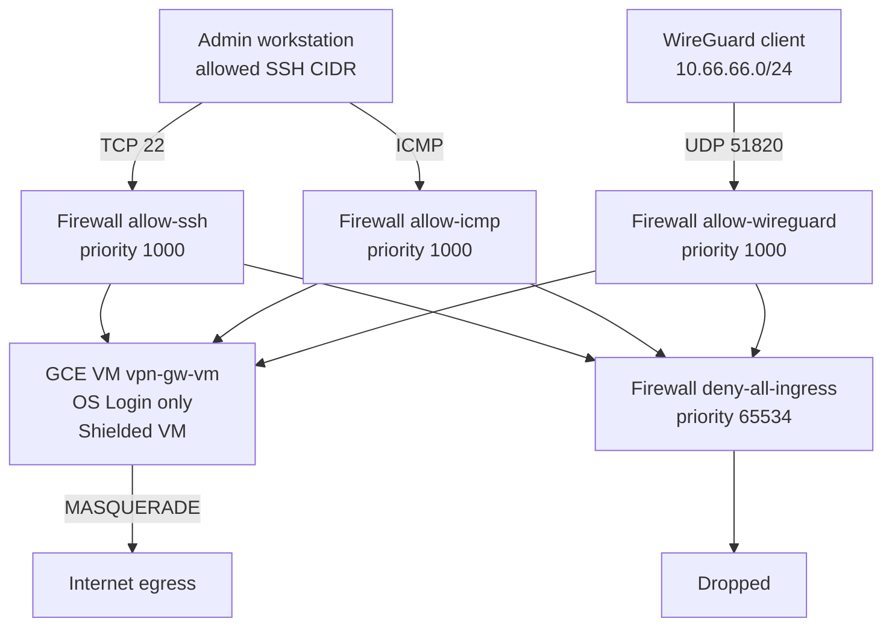

# Architecture

The gateway is a single Compute Engine VM in its own VPC. There is no shared
network with application workloads: the VPN terminates on this VM and client
traffic leaves through its external IP.

## Components

| Component | Terraform resource | Notes |
|---|---|---|
| Network | `google_compute_network.vpn` | No auto subnets, global routing |
| Subnet | `google_compute_subnetwork.vpn` | `10.10.0.0/24`, flow logs at 50% |
| Static IP | `google_compute_address.vpn` | External, premium tier |
| SSH rule | `google_compute_firewall.ssh` | TCP/22 from `ssh_allowed_cidrs`, logged |
| ICMP rule | `google_compute_firewall.icmp_diagnostics` | Same admin CIDRs |
| WireGuard rule | `google_compute_firewall.wireguard` | UDP/51820 from `vpn_allowed_cidrs` |
| Deny rule | `google_compute_firewall.deny_all_ingress` | Priority 65534, explicit deny |
| VM | `google_compute_instance.vpn` | Debian 12, Shielded VM, OS Login |
| Service account | `google_service_account.vpn` | No project-level roles except logging and metrics |
| Secret | `google_secret_manager_secret.client_config` | Client configs as JSON |

## Access flow

## First boot

1. Terraform creates the network, firewall rules, service account, secret and VM.
2. The startup script installs `wireguard-tools`, `iptables`, `jq` and `curl`.
3. The VM generates a server key and one key pair per client in `vpn_client_names`.
4. `wg0` is configured with address `10.66.66.1/24`, the configured UDP port,
   forwarding and NAT through the default interface.
5. Client configurations are uploaded to Secret Manager through the metadata
   server token.
6. A marker file prevents the bootstrap from running twice.

## Design decisions

- **WireGuard over OpenVPN**: fewer dependencies, simple key model, low CPU.
- **Public IP plus allowlist**: SSH is reachable only from explicit ranges;
  `0.0.0.0/0` is rejected by variable validation.
- **No project-wide SSH keys**: OS Login and
  `block-project-ssh-keys=TRUE` keep access tied to IAM identities.
- **Keys never enter Terraform**: private keys are generated on the VM and
  only client configs are stored in Secret Manager.
- **Explicit deny rule**: makes dropped traffic visible in firewall logs.

## Known limitations

- Single VM and single zone: no high availability.
- No Cloud NAT: client egress uses the VM external IP.
- No automatic key rotation: recreating the VM generates new keys.
- IPv4 only inside the tunnel.
- The startup script embeds the static IP, so it is unknown at plan time on
  the first run; plan diffs do not show changes inside it.
