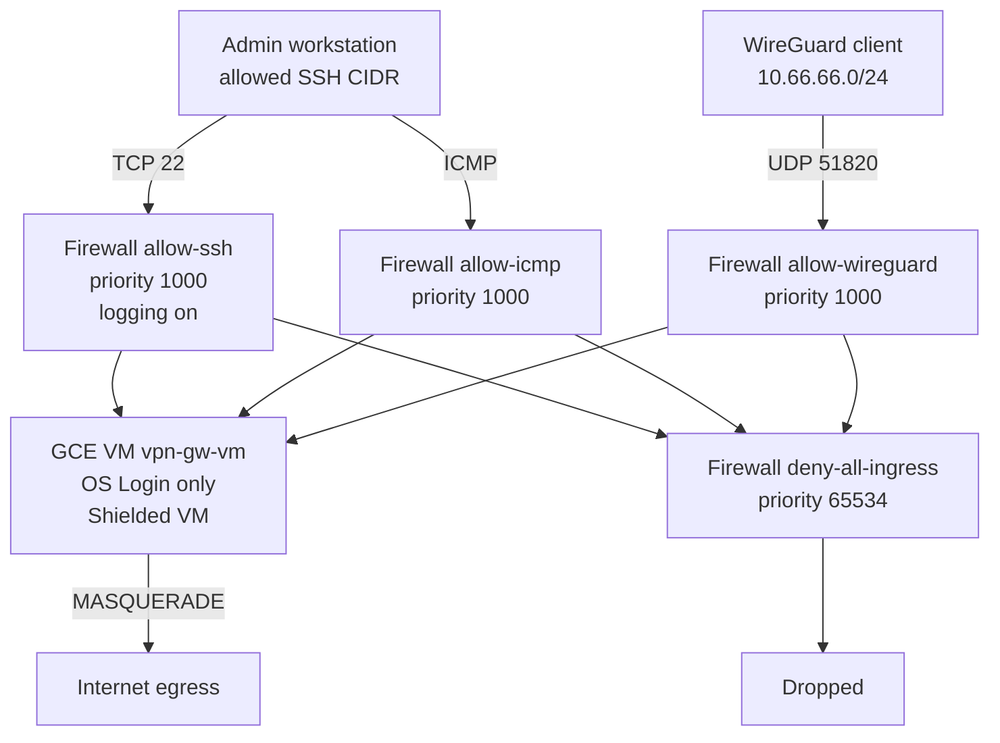
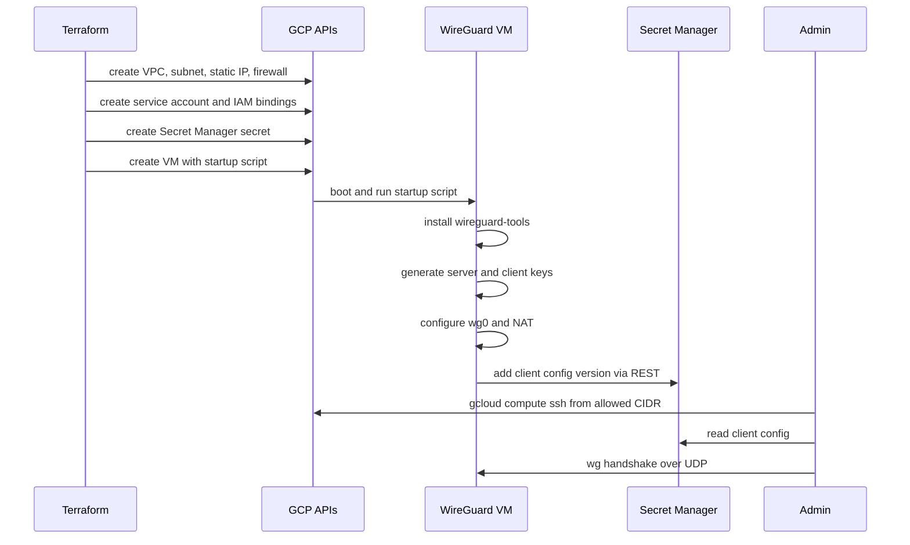

# SSH и VPN access flow

Схема доступа к WireGuard-шлюзу: административный SSH только с разрешённых
CIDR, клиентский трафик — по UDP, всё остальное явно запрещено.

## Сетевой поток

## Последовательность первого запуска

## Правила, которые видны на схеме

- SSH и WireGuard — единственные ingress-правила с priority 1000, плюс
  ICMP-диагностика с тех же административных диапазонов.
- Явный deny на priority 65534 делает отказ видимым в логах.
- У VM нет project-wide SSH keys: доступ только через OS Login.
- Клиентские приватные ключи не проходят через Terraform.
- Исходящий трафик клиентов уходит через внешний IP шлюза.
